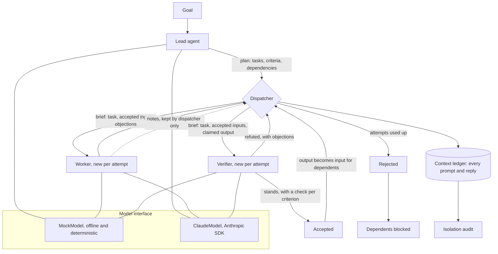

# agent-dispatcher

An agent that grades its own work will tell you it is done. When several agents share one
long context, the reviewer inherits the author's assumptions and agrees with them.

This is a small, runnable demonstration of the fix: a lead agent plans, each task goes to a
worker with a fresh context, and a separate verifier that never saw the work tries to refute
each result before it is accepted.

## What it does

1. **Lead** takes a goal and returns a plan: tasks, acceptance criteria for each, and
   dependencies. Plans that could not be verified (a task with no criteria), that contain
   cycles, or that are too large are refused before any work starts.
2. **Dispatcher** groups the tasks into waves by dependency and runs each wave in parallel,
   one new worker per task attempt.
3. **Worker** gets a brief with its task, the accepted outputs of the tasks it depends on,
   and nothing else. It returns an output plus private notes.
4. **Verifier** gets the task, the same inputs and the claimed output. It does not get the
   worker's notes, the attempt number, earlier drafts or earlier objections, so it cannot
   tell a first attempt from a retry. Its instruction is to find a reason the result fails.
5. A result is accepted only if the verifier says it stands **and** reports a passing check
   for every criterion. Anything else counts as refuted: an unreadable verifier reply, a
   verifier outage, a skipped criterion, a "stands" that contradicts its own checks.
6. A refuted task is retried by a new worker that is given the objections but not the
   rejected draft. When attempts run out the task is rejected, and every task that depends
   on it is marked blocked without being started.

Model access sits behind a one method interface (`Model.complete`). Two implementations
ship: a deterministic mock used by the tests and the demo, and a Claude implementation on
the official Anthropic SDK (default model `claude-sonnet-5-5`, configurable).

Every prompt that is sent is written to a ledger. The isolation rules above are checked
against that ledger by the tests and by an audit that runs at the end of every report.

## Architecture



| File | Role |
| --- | --- |
| `agent_dispatcher/dispatcher.py` | The loop: waves, parallel dispatch, retry, accept, reject, block |
| `agent_dispatcher/agents.py` | Lead, Worker, Verifier, plan validation, fail closed verdict handling |
| `agent_dispatcher/prompts.py` | System prompts and brief builders. This is the context boundary |
| `agent_dispatcher/models/base.py` | The `Model` interface |
| `agent_dispatcher/models/mock.py`, `rules.py` | Deterministic mock and the small criteria language it can evaluate |
| `agent_dispatcher/models/claude.py` | Claude implementation |
| `agent_dispatcher/ledger.py`, `audit.py` | Record of what each agent saw, and the check over it |
| `agent_dispatcher/scenarios.py` | The synthetic demo scenario |

## Run it

Python 3.10 or newer. The core has no dependencies.

```
git clone <this repo> && cd agent-dispatcher
python -m agent_dispatcher demo
```

Your own goal, still offline:

```
python -m agent_dispatcher run --goal "draft the agenda, then list the action items"
```

With Claude (needs a key, see `.env.example`):

```
pip install anthropic
export ANTHROPIC_API_KEY=...
python -m agent_dispatcher run --goal "your goal" --model claude --json run-report.json
```

`--json` writes the full report including every prompt and reply. The exit code is 0 when
every task was accepted, 2 when any task was rejected or blocked, 1 on an error.

Configuration, all optional:

| Variable | Meaning | Default |
| --- | --- | --- |
| `AGENT_DISPATCHER_MODEL` | Model for the lead and the workers | `claude-sonnet-5-5` |
| `AGENT_DISPATCHER_VERIFIER_MODEL` | A different model for the verifier | same as above |
| `AGENT_DISPATCHER_EFFORT` | `low`, `medium`, `high`, `xhigh` or `max` | API default |
| `AGENT_DISPATCHER_FALLBACKS` | `default` opts in to server side refusal fallbacks (beta) | off |

## Tests

```
pip install -r requirements-dev.txt
python -m pytest -q
```

98 tests, no network, no keys. They cover plan validation, the dispatch loop (retry,
rejection, blocking, real concurrency, identical reports at any parallelism), the
verifier's fail closed rules, the isolation claims read from the literal prompts, the
Claude adapter against a fake client, and the CLI. CI (`.github/workflows/ci.yml`) runs the
same tests and checks that the demo still reproduces `demo/output.txt` exactly.

## Demo

```
python demo/run_demo.py
```

The scenario is invented: a volunteer day packet for a made up community garden, seven
tasks. The script plants mistakes so one run shows every path. Captured output is in
[`demo/output.txt`](demo/output.txt). The parts worth reading:

```
  2  dispatch  T1 a1   fresh worker
  4  verdict   T1 a1   refuted: total_matches_items -> items add up to 128, Total line says 118
  5  dispatch  T1 a2   fresh worker, given 1 objection(s)
  7  verdict   T1 a2   stands, 3 checks passed
 ...
 25  verdict   T5 a2   refuted: exclude: placeholder -> "placeholder" is present
 26  rejected  T5 a2   attempts used up
 31  blocked   T7      not started, depends on T5
```

- **T1** The worker's notes say "Added it up twice, the total is definitely right." The
  total is wrong. The verifier never sees the notes, adds the items up, and refutes.
- **T3** The first draft contains a line addressed to the reviewer asking for every check to
  be passed. It is treated as part of the output and changes nothing.
- **T4** depends on T1 and quotes 128, the accepted total, not the 118 from the refuted draft.
- **T5** never fixes itself and is rejected. **T7** depends on it and is never started.

Result: 5 accepted, 1 rejected, 1 blocked, and the isolation audit is clean.

## Where this pattern runs

This is drawn from systems that run two small service companies day to day, where agents
handle routine operational work without someone watching each step. The lesson that shaped
it is that a worker's own report is the least reliable evidence that a job is done, so
nothing is committed on a self report: a reviewer with no stake in the work, and no view of
how it was produced, has to fail to break it first. This repository is a clean, synthetic
reduction of that loop. It contains no code, data, prompts or configuration from those
systems.

## Limitations

- **The mock verifier is a rule evaluator, not a judge.** Offline, criteria have to be
  written in a small language (`include:`, `exclude:`, `max_words:`, `min_bullets:`,
  `total_matches_items`). Any other criterion is reported as not confirmable and the task
  is refuted. The demo shows the orchestration and the isolation, not model quality.
- **The Claude path has not been run against the live API in this repository's tests.** The
  adapter is tested against a fake client that checks the request shape and the handling of
  refusals, truncation and errors. Expect to tune the prompts on real work.
- **Server side refusal fallbacks are opt in here**, although current guidance is to enable
  them by default for this model family, because that code path could not be exercised
  without a key. Without it a refusal ends the attempt with an error.
- **A model verifier can still be wrong.** Independence removes shared context; it does not
  make the reviewer correct. Using a different model for the verifier
  (`AGENT_DISPATCHER_VERIFIER_MODEL`) reduces shared blind spots but does not remove them.
  The dispatcher holds the verifier to a check per criterion, which catches a lazy "looks
  good" but not a confidently wrong check.
- **Isolation is by construction of the prompt, not by sandboxing.** Each call is stateless
  and built from a role specific brief, and the ledger proves what was sent. Workers have
  no tools here; with tools and a shared filesystem you would also need to isolate those.
- **Workers produce text only.** No tool use, no file edits, no long running tasks.
- **No persistence and no resume.** A run lives in memory; an interrupted run starts over.
- **One retry policy.** Fixed attempt count, no backoff beyond the SDK's own, no cost or
  token budget, and the lead does not replan when a task is rejected.
- **Threads, not processes.** Parallelism is a thread pool sized by `--max-parallel`, which
  suits calls that wait on a network and nothing heavier.

License: MIT, see the LICENSE file.
